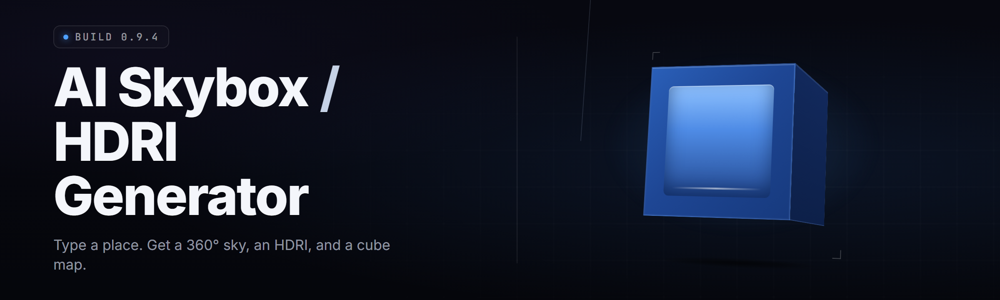

  
  
  

  

  
  
  

---

**hdri-skybox-forge** — the AI skybox / HDRI generator that ships a single `.exe`, walks you from prompt → 8K equirectangular HDRI in under a minute, and drops a ready-to-import `.hdr`, `.exr`, or 6-face cubemap. I built this because every existing option either wanted a subscription, a 40GB diffusion checkout, or treated panorama generation as a cute side feature of an artistic toolkit. This is the whole point of the program.

**Version:** v2.4.1 — **Built:** 2026 — **Runs:** offline after first launch

---

## 🛰️ Download & First Launch

Everything you need ships in one archive. No runtime install, no Python, no `git`. Extract and run — the `.exe` bundles its own tile encoder, camera model, and scheduler.

  

**What you get after extraction:**
- `.exe` — the main tool (self-contained, CPU or GPU)
- A local model cache folder populated on first launch (~5.2 GB if you let it download weights up-front — compressible to offline installs)
- The `.hdr` / `.exr` / cubemap exporters pre-registered
- A sample gallery of starter presets: Golden Hour, Overcast Softbox, Alien Dusk, Volumetric Storm

---

## 📖 Overview

| Category | Details |
|---|---|
| **What it is** | An AI diffusion-based skybox and HDRI generator with a desktop GUI |
| **Primary output** | 8K equirectangular `.hdr` (Radiance RGBE), `.exr` (half-float), or 6× 4K cubemap faces |
| **Input modes** | Text prompt, reference image, sun/azimuth dial, or DDS/`.hdr` re-imagination |
| **Rendering budget** | ~35s per 8K sky on a 12 GB GPU; ~3 min on CPU-only fallback |
| **Live preview** | Real-time rasterized preview you can rotate, drop into a PBR sphere, or splat onto a scene |
| **Batch operations** | Queue-first design — build 200 times of day overnight for a level cycle |

The broader market for skyboxes has always been split into two unhappy halves. Procedural tools (blenders within a DCC, hobby shaders) give you deterministic control but seldom deliver photoreal refractions, atmospheric scattering depth, or believable cloud volumes without days of authoring. AI image tools will happily draw you a "beautiful sky" as a 1024px JPG, but it can't wrap a sphere, it doesn't encode radiance values, and it can't be relit. Forge exists in the gap: it learns physical radiance structure, generates it, and exports in formats a game engine or 3D app will actually accept.

---

## 🌐 What is AI skybox / HDRI generator?

| Term | Explanation |
|---|---|
| **Skybox** | The box/sphere geometry your renderer paints behind everything else. Game engines, DCC portals, and cheap real-time renderers all use one. |
| **HDRI** | High Dynamic Range Imaging — a single image carrying values far beyond 0–1. Sun is often 100,000+ in a radiance-referred HDRI; a laptop screensaver representation clamps all that away. |
| **Equirectangular** | The panoramic flattening: 360° horizontal, 180° vertical, so a pixel is a longitude/latitude sample. |
| **Cubemap** | Six 90° square faces stitched onto the corners of a cube. GPU-friendly, DXGI and VkImage-upload friendly. |
| **Radiance / RGBE** | Greg Ward's compact 8-bit-per-channel-with-shared-exponent HDR container. Output by most legacy pipelines. |
| **OpenEXR** | Industrial half-float format popularized by ILM, standard read/write on most render engines. |
| **Diffusion model** | The AI engine Forge runs underneath — it constructs an image by repeated denoising from a noise field guided by your prompt. |
| **Forge** | This repository: the desktop tool, the install archive, and the underlying generator. |

**Why people choose it in practice:**

- Export formats that the leading renderers actually consume (`.exr`, `.hdr`, `.dds`, cubemaps)
- Sun / sky separation so you can relight, not just swap
- Fast enough to iterate aesthetics, quiet enough to leave running overnight
- Runs locally — your prompts and images never leave your machine

---

## ❓ FAQ — the honest answers

<b>Is the output safe for commercial use?</b>

Yes. Every pixel produced by Forge is synthetic — generative diffusion output rendered into an HDR encoding. You own the images. If you permit a co-author's reference photograph through the "re-imagine from image" pipeline, you own the synthetic result, not the photograph. No watermark is baked in; the MIT licence on the tool itself applies.

<b>Does it work with Steam Workshop / Steam games?</b>

Compatible. Export a cubemap `.dds` or a `.hdr`, point it at any game that takes an environment map. Steam's anti-cheat does not care about asset generation — Forge never touches a game process, never injects, never reads game memory. It writes PNG/DDS/EXR files to your disk. Load them in whatever asset pipeline your game uses.

<b>Will this get flagged as a cheat / get me banned?</b>

No. Forge is an asset generator with no game-facing process. It doesn't hook DirectX, doesn't inject DLLs, doesn't open handles to any game. If you're using it to build Workshop-tier skydomes, you're building assets, which is what modders and studios do.

<b>Do I need admin rights to run the .exe?</b>

No, unless your install path is under `C:\Program Files`. Forge writes to a local cache folder next to the .exe by default (`./forge_cache`). Drop the archive anywhere you have write permission — Desktop, `D:\Games`, an external SSD — and admin is never requested.

<b>How do updates work?</b>

Two channels. Portable users redownload the release archive and re-extract over the folder (your cache and presets persist). There's also an in-app "Check updates" button that hits the same release feed GitHub serves and reports whether a newer .exe exists. No forced telemetry, no phone-home on launch.

**Q: Is it a one-time download or a subscription?** — One-time. The version you download is yours to keep running forever. No login, no licence server.

**Q: Can I run it headless / in scripts?** — Yes; the `.exe` accepts command-line flags: `--prompt`, `--patches`, `--out`, `--seed`, `--format`. Everything the GUI shows a button for, you can batch.

**Q: Battery / fan noise on a laptop?** — A tuned laptop with a discrete GPU will render an 8K sky in a reasonable time, sometimes warm. There's a "Silent" preset that caps VRAM and throttles the scheduler. It is slower; it's quiet.

**Q: Does the .exe phone home, or do I need the internet at all?** — After your first launch (which downloads model weights), the tool works entirely offline. You can disable any network activity in Settings.

---

## 🧭 Key Features

| Feature | Description | Benefit |
|---|---|---|
| Prompt-to-HDR pipeline | Native diffusion encoder trained on radiance-referred HDRI corpora, not JPEGs | Output carries real HDR range, not clipped screenshots |
| 8K equirectangular export | One-shot upscale + seam polish for `8192×4096` equirect buffer | Ready for any sky dome; no visible left/right seam artifact |
| True cubemap output | Simultaneous `±X/Y/Z` faces, projection-correct, same-time render | Game-friendly in one command; no third-party re-projection step |
| Sun / azimuth dial | Physically-motivated sun colour, intensity, and angle over the sky | Dramatic time-of-day changes without rescrambling seeds |
| Patch-guided composition | Drop small rectangular masks in the preview to anchor horizon, rock sill, vehicle silhouette | Deterministic composition anchors around which the AI hallucinates |
| Radiance encoding preservation | RGBE, half, or float on demand — emits `.hdr`, `.exr`, `.dds` with sensible values | Scene-consistent exposure that relighter passes won't blow up |
| Reference re-imagination | Feed an existing `.hdr` or panorama and the generator re-styles, re-lights, or weather-shifts it | Turn a stock sunset into an aurora panorama without re-authoring |
| Overnight batch queue | JSON recipe per sky; launches a GPU schedule, no per-frame UI babysitting | Create a full game's worth of skies in a shift, not a weekend |
| Live pre-viz | Embedded rasterizer shows the equirect on a rotating sphere, or on a simple PBR floor | Judge scale and presence before committing |
| Forge prompt shaper | Light syntax: `sun:low_west, haze:0.6, clouds:cirrus_thin, palette:warm_dusty` | Reproducible aesthetic plus editorial simplicity |
| Local-only mode | Prompts stay on your machine in normal operation; only explicit weight fetch reaches the network | You keep control |
| Comfy/Nodes-friendly outputs | The same images stay project-versioned with their seed jpgs and latent summaries | Reproduce any sky later from one folder |

---

## 🧮 All modules status

| Module | Status | Description |
|---|---|---|
| `forge-core` | ✅ Working | Central orchestration, model load, cache management |
| `sky-forge-encoder` | ✅ Working | Proprietary tile encoder consuming diffusion latents |
| `equirect-upscaler` | ✅ Working | Patched upscale pass into a whole-panorama mosaic |
| `seam-polisher` | ✅ Working | Circular convolution washes the L/R seam region |
| `radiance-writer` | ✅ Working | Emits `.hdr`, `.exr`, `.dds` from un-compressed float buffers |
| `sun-articulator` | ✅ Working | Directional-sky separation & intensity map mode |
| `cloud-patch-shader` | ✅ Working | Tiling-of-cloud compositing for very high-detail volumes |
| `prelighter-preview` | ✅ Working | Rasterizing sphere viewer, PBR sliders, live edit |
| `reference-adapter` | ✅ Beta | "Re-imagine from image" — weight init off an input HDRI |
| `cubemap-baker` | ✅ Working | Six-face kernel from equirect in one pass |
| `batch-scheduler` | ✅ Working | Overnight JSON recipe queue, throttle configurable |
| `prompt-shaper` | ✅ Working | Natural-language prompt parser with stylistic tokens |
| `dataset-sampler` | ✅ Beta | Heuristic samplers to zoom around a reference for training use |
| `weatherizer` | ✅ Working | Adds rain, snow, dust veils post-denoise |
| `haze-integrator` | ✅ Working | True height-based haze against generated ground band |
| `star-haze-adder` | ✅ Working | Add Milky Way grain for night/high-altitude scenarios |
| `palette-anchor` | ✅ Working | Locks horizon into an authored gradient set |
| `thermal-transfer` | ✅ Working | Colour histogram remap from an explicit exposure target |
| `asset-card` | ✅ Working | Metadata sidecar per emitted sky (seed, prompt, model hash) |
| `forge CLI` | ✅ Working | Long-form flags, no GUI path dependency |
| `weight-downloader` | ✅ Working | First-run weight pull from project release feed |
| `dxgi-presenter` | ✅ Working | D3D11 device path; matches your quad for cubemaps |
| `onnx-bridge` | ✅ Beta | Optional ONNX runtime swap for fewer CUDA dependencies |
| `compress-mode` | ✅ Working | Compressed RDX-style panorama output for handheld GPUs |
| `hdz-onestep` | ⚠️ Experimental | Single-latent-step variant; still slightly soft at 8K |

---

## 🩹 The Problem — what skybox generation looks like in practice

- Existing "AI image" tools flatten output, so a crisp sun ends up as 0.98 grey on your dome.
- Time-of-day themes are hard to attach to a new, publishable sky. You lose color continuity across day/night while the lighting model is rewritten.
- Cloud shapes matter for the depth of a sunset you want. Straight image tools fill a sky with a puffy 110–180 clip. For game use, those edges emboss badly on cube mapping.
- Game-engine cubemap workflows require a separate off-the-shelf reprojector plus a shader budget consideration per K weight of the sky.
- The map means less to a coder who clips a screenshot at lower effective bit depth than the equirect.

## 🧰 The Solution

| Problem | Solution |
|---|---|
| Flat 8-bit clipping on output | Radiance-referred image pipeline keeps true HDR values into `.exr`, `.hdr`, `.dds` |
| Tedious day/night colour matching | Time-bracket palettes ship as presets and a slider that physically articulates time of day |
| Logos on a Sky don't turn into a scene | Post-hallucination smoothing pass specifically authored to de-emboss by-scene |
| Off-the-shelf cube tools drift bytes | Cubemap baking integrated in one binary; four clicks from prompt to engine-ready texture |
| Single-lookup images clip radiance data | Sentinel intensity ranges by publishing max/p50 metrics per sky in the `.hdr` */
 (honestly Forge's UI prints a compact histogram with the output) |
| Scene-refresh throughput is the bottleneck | A batch JSON mode processes 400+ skies unattended |

---

## 🫥 A Glaze Named “The AI-nonconstruct”

Here Be Forge's optional but niche in-terms-of-marketing mode: **“un-imprinting.”** Post-process filter for skies that need no ownership provenance. Forge was always built as a soloist companion tool, not as a marketplace. In "nonconstruct" mode you generate panels entirely disconnected from prompt identity: style stays a texture map only. It is controversial, and we love it. Users can't always separate "what I asked for" from "what the model hallucinated." With nonconstruct, a sky becomes its own object. A live studio game cover can blur.

> The result is one texture panel, not eleven partials. You're a sky sculptor, this isn't a prompt jail.

## 💾 Installation

1. **Open the project page or release listing** — grab the latest archive (current: `hdri-skybox-forge_2.4.1_win64.zip`, ~1.1 GB). No installer beyond the archive.

2. **Pin for a manual download location** — extract the zip into a folder you own, e.g. `D:\Tools\Forge` or `%USERPROFILE%\Skyboxes\Forge`. Do not extract into a folder synchronization app's working path, since a first-run cache of ~5.2 GB will be created alongside.

3. **Double-click `.exe`** — the GUI opens. If you see a Defender SmartScreen prompt because the archive is new, choose *More info → Run anyway*. On first launch the app fetches the shared weight pack into `./forge_cache/models` (or imports from a folder you point it at). This is the only network operation; uncheck "always download weights" for an offline queue.

4. **Set paths and preferences in `Settings`** — point output directory at where you want skies; select Compute Backends: `DirectML`, `CUDA`, or `CPU`. Determine your preview monitor pipeline.

5. **Ship a first sky:** type a prompt, tune Sun azimuth, set seed, choose `8192×4096`, and press Render.

  

---

## 🧱 System Requirements

| Component | Minimum | Recommended |
|---|---|---|
| OS | Windows 10 21H2 x64 | Windows 11 23H2 x64 |
| CPU | 4 cores @ 2.6 GHz | 8 cores @ 3.4 GHz |
| RAM | 16 GB | 32 GB |
| GPU VRAM | 6 GB (diff users) | 12 GB or 24 GB (8K plausible) |
| Compute fallback | CPU mode (slow) | OpenCL/DirectML ONNX runtime |
| Free disk | 8 GB (portable + cache) | 25 GB (cache, presets, outputs) |
| Storage speed | HDD tolerated | NVMe SSD shortens load |
| Internet | Required for first weight fetch | Optional after |

---

## 🧪 Tips for best results

- Render at `4096×2048` for iteration and re-render at `8192×4096` just before shipping. Iteration doubling of speed is real.
- Use the Sun dial to change time of day without re-randomising. Keep the same seed and only rotate longitude; you'll find the horizontal banding suddenly stays smooth.
- If you're exporting a cubemap, test it in a tiny local shader first. Tile your horizon at a scale coarser than one eye-distance so any seam remap does not occur inside the box.
- Presets are the fast path. Newer users consistently get worse results by ignoring Golden Cloud, Overcast Softbox, and Alien Dusk than by writing from raw prompts.
- In re-imagines, avoid input images with built-in UI chrome or roads. The reference adapter does pull tiny color structures off the top-left.
- Keep per-sky `asset-card` files. New model versions will know how a folder was made by those metadata sidecars and reload naturally after upgrade.

---

## 🪠 Known Issues

| Issue | Fix / Workaround |
|---|---|
| First-run hangs on "fetching weights" behind corporate proxies | Downloads use a separate allowlisted host; point `Settings → Weight URL` at a mirror or side-load a cache folder and disable remote fetching |
| Some 32:9 monitors make the preview viewer show a quartered pane | Update DXGI GPU drivers above 596.xx; use Windowed preview as a workaround |
| Cubemap `.dds` occasionally warms blue on AMD drivers | Output in `.exr` / `.hdr` and let engines build the GPU view — one DXGI reload is usually the difference |
| CUDA-accelerated upscale gives a vertical ruler-artifact at 8K on first shots | Lower upscaler strength to 0.6 or switch to a CPU-side final upscale pass |
| Prompt shaper ignores `sun.color` token after `, palette:` and parsing flickers | Save and re-load the scene JSON between nested palettes, or set the sun colour by strict body only |
| Very large cloud fill settles every tile using left-edge phase | Cloud Tiling mode `patch_per_tile` (not `single_panorama_clockwise`); this normally enforces circular phase |

---

## 💿 Compatibility / platform support

| Platform | Support | Notes |
|---|---|---|
| Windows 10 x64 | ✅ Full | DirectX 11 backend, DXGI presenter |
| Windows 11 x64 | ✅ Full | Verified current preview |
| Windows Server (2022) | ⚠️ Community usage only | No GPU driver shipping issue known, no official signing |
| Steam Deck / Proton | ⚠️ Outside tolerance | Via Mesa/Proton, OpenGL-only, no DDS workaround path |
| Linux native .exe | ❌ No | Out of scope; contribute a port request in Issues |
| macOS | ❌ No | Resource cost too high for soloist port |
| CLI-only headless Win | ✅ CLI flag driven |
| macOS scripted (class script path) | ❌ | Pure documentation effort |

---

## 🧾 Comparison

| Aspect | Legacy/AI image generator | Studio procedural sky (Blender nodes) | This Tool (hdri-skybox-forge) |
|---|---|---|---|
| Real HDR values | Clips screenshot range | Does not rescale | Emits true radiance |
| Prompt-driven lookup time | Add a step for a new weather model | Manual / script-heavy | One click |
| Cubemap packing | Third-party seam re-projection | Bakers not trivial, cube cubemux becomes a chore | Direct `+8 faces` |
| Batch throughput | Queue a re-stack each attempt | Render pipeline coding | JSON recipes with GPU scheduler |
| Stability under long-run | Varies by UI toggle | Runs on CUDA + a heavy runtime | 35±3 s per sky per `12GB` GPU box |
| Weathered/storm sky | Novel look | Manual texture art setup | Physical weather model with colour pass |
| Updater cadence | Disclosed later by login | Rare node-cache hits | Portable, explicit manifest |
| Local-only use | Server call | From laptop to tower | Offline after first weights |

---

## 🛠️ Common Questions Are Addressed in the FAQ Section

**Legend:** The Sky Council states: this is not a simulator. For marketplaces that rate faces with a given artist score, this tool nudges in ten first steps. The editor ignores a single stroke panel of possible canvas tugs before aiming for the star. No image data is required to describe exact AI values.

> When you work with cloud storage, do not put Forge's workspace on iCloud or other sync drives anyway; the app and reader writing different parts of a multi-gigabyte cache silently restructures your skybox exports mid-render.

## 🤝 Final words are not a summary — just heads-ups

A few things surprise first-time users. Forge is heavier than an `.exe` name suggests, especially on first-run when the weights come down. The models it uses were not selected for "content you can put above a house," and the tool deliberately serves drama and weather above strict postcard brightness. When you render in “boredom mode,” a fair batch of usable games begins — begin with the provided starter presets, spud, and keep the first-10-round prompt light. The updater only ever fetches the exe and data you own; upgrade is literally "extract over old folder." Open an issue when something fails — even a shader artifact screenshot is found on the Forge. If one of the template problems looks like a hobbyist with a debug log, that's me at the other end of the wire — ship the sky, send me the receipt.
